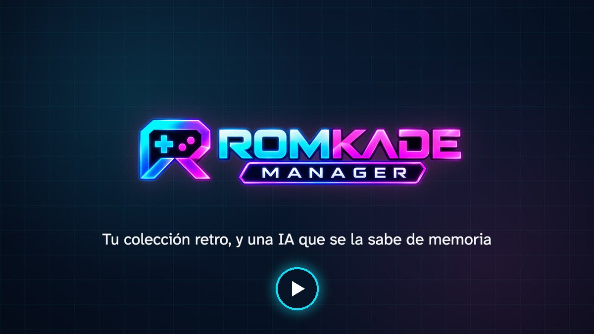

<p align="center">
  
</p>

<h3 align="center">Tu consola retro, por fin ordenada.<br>Contrólala desde tu ordenador, y pide a ChatGPT o Claude que empiece la partida.</h3>

<p align="center">
  <b><a href="https://romkade.com/es/">romkade.com</a></b> &nbsp;·&nbsp; <a href="README.md">English</a> · <a href="README.fr.md">Français</a> · <b>Español</b>
</p>

<p align="center">
  <a href="https://romkade.com/video/hero-es.mp4"></a>
  <br><sub>▶ Ver la presentación en 50 segundos</sub>
</p>

---

**ROMKADE Manager** convierte tu consola retro portátil (Anbernic, Miyoo, TrimUI…) en una consola que controlas desde
tu ordenador. Toda tu tarjeta microSD se convierte en una bonita biblioteca con carátulas y fichas de juego, y **Duke**,
tu asistente IA, conoce cada uno de tus juegos. Sin cable y sin sacar la tarjeta: todo va por Wi-Fi.

## ✨ Lo que puedes hacer

- 📚 **Ver toda tu colección.** Cada juego de la tarjeta, con carátula, resumen, tráiler y género. La búsqueda lo encuentra aunque escribas mal.
- 🤖 **Preguntar a Duke.** «¿Un juego para dos?», «¿Cómo paso este nivel?»: el asistente IA conoce tu biblioteca y abre los juegos por ti.
- 💬 **Hablar con tu consola desde ChatGPT, Claude o Google Home.** «Abre Tetris», «Pon el volumen al 40 %», desde tu móvil o tu ordenador.
- 🎮 **Jugar desde tu ordenador.** Abrir un juego, salir, continuar desde una partida guardada, ajustar el volumen.
- ➕ **Añadir juegos arrastrando y soltando.** Por Wi-Fi, directamente en la carpeta correcta, comprobados antes de copiar nada.
- 💾 **Proteger tus partidas guardadas.** Todas copiadas en tu ordenador en un clic, y restauradas cuando las necesites.
- 🕹️ **Mandos y sonido Bluetooth.** Elige quién juega con qué mando y envía el sonido a un altavoz Bluetooth.
- ⏳ **Tiempo de juego.** Cuánto tiempo juegas, con avisos si quieres.

<table>
  <tr>
    <td width="50%"><p align="center"><sub>Duke conoce tus juegos</sub></p></td>
    <td width="50%"><p align="center"><sub>Tu biblioteca, consola a consola</sub></p></td>
  </tr>
  <tr>
    <td width="50%"><p align="center"><sub>Quién juega con qué mando</sub></p></td>
    <td width="50%"><p align="center"><sub>El sonido del juego en un altavoz</sub></p></td>
  </tr>
</table>

## 🎮 Compatible con tu consola

| | Consolas y sistemas |
|---|---|
| ✅ **Verificadas** | Anbernic RG35XX (Pro, Plus, H, SP, 2024), RG28XX, RG34XX, RG40XX, RG CubeXX con Stock OS Mod · Miyoo Mini y Mini Plus con Onion OS |
| 🧪 **Experimentales** | Knulli, Batocera, ROCKNIX, muOS, ArkOS, spruce, MinUI / NextUI, Android con RetroArch |

Basta con que tu consola esté en la misma red Wi-Fi que tu ordenador.

## 🚀 Empieza en 3 pasos

1. **Instala Docker Desktop**, gratuito en macOS, Windows y Linux.
2. **Inicia ROMKADE Manager.** En un terminal, en una carpeta vacía:

   ```bash
   curl -fsSLO https://github.com/RomKade/romkade-manager/releases/latest/download/compose.yaml
   docker compose up -d
   ```

   En Windows, escribe `curl.exe` en lugar de `curl`.
3. **Abre http://localhost:8765**, crea tu cuenta ROMKADE y déjate guiar: ROMKADE Manager encuentra tu consola en la
   red por ti.

Guía paso a paso, con capturas: **[romkade.com/es/instalacion](https://romkade.com/es/instalacion/)**.
Próximamente: la instalación en un clic desde las Extensiones de Docker Desktop.

## 🔒 Tus juegos, tu consola

- **Ningún juego incluido.** ROMKADE Manager ordena los archivos que ya tienes.
- **Tus datos se quedan en casa.** Biblioteca, partidas guardadas y ajustes viven en tu ordenador.
- **Nada cambia sin ti.** La consola solo se modifica cuando lo pides: añadir juegos, restaurar una partida guardada, ajustes de mandos o de Bluetooth.
- **Privado por diseño.** La interfaz solo se abre en tu ordenador, nunca en Internet.

## 🛠️ Bajo el capó

Python (FastAPI) y SQLite en el servidor, una interfaz React, Typesense para la búsqueda, todo empaquetado con Docker
para Intel/AMD y ARM. ROMKADE Manager llega a la consola por SSH en tu red local; ROMKADE Cloud, un servidor MCP, la
conecta con ChatGPT, Claude y Google Home. Instalación desde el código fuente, desarrollo y cada función en detalle:
[referencia técnica](docs/reference.es.md).

## Licencia

© 2026 ROMKADE. El código se publica para lectura y evaluación; cualquier otro uso requiere el permiso por escrito de
ROMKADE (ver [LICENSE](LICENSE)). ROMKADE no está afiliado a ningún fabricante de consolas; las marcas citadas
pertenecen a sus propietarios.
