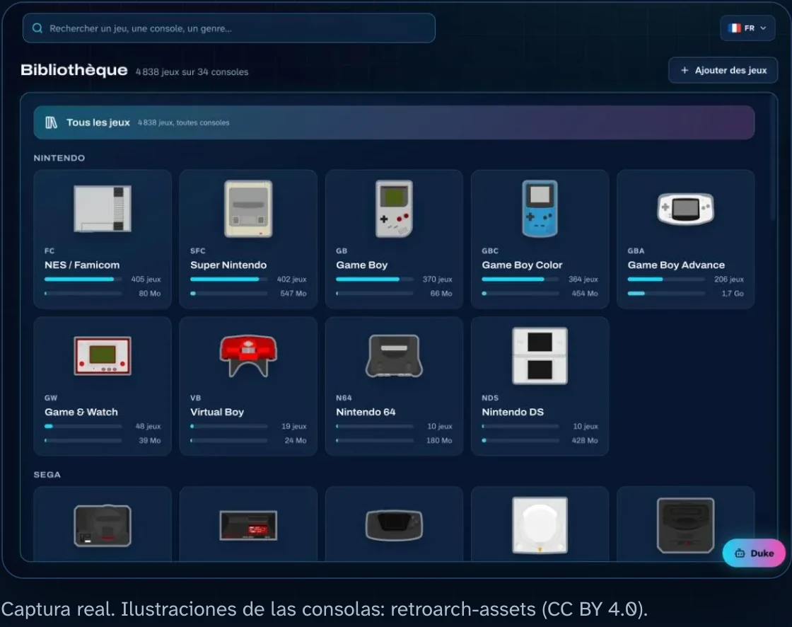
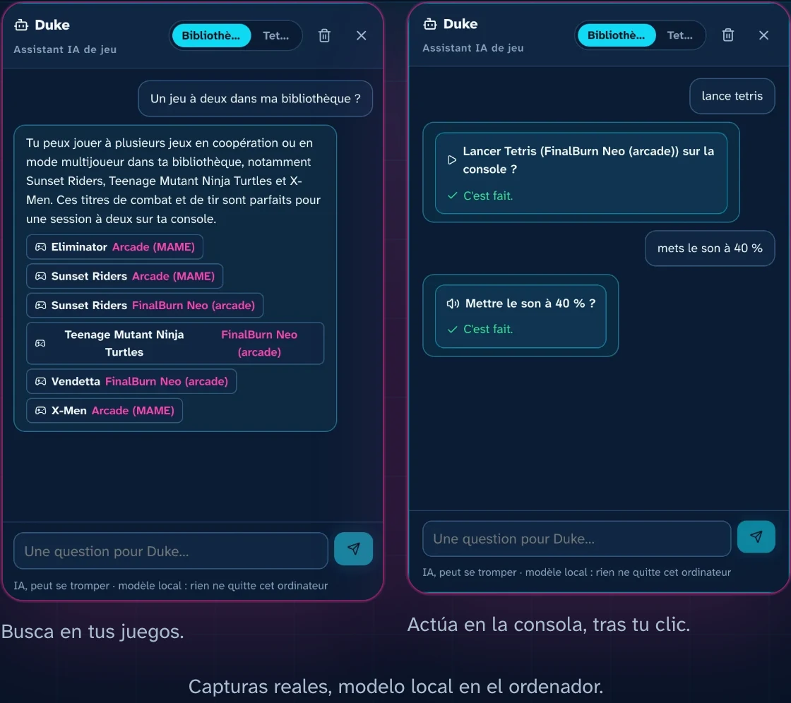
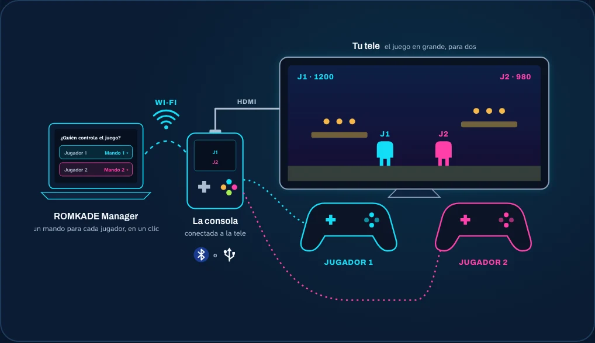
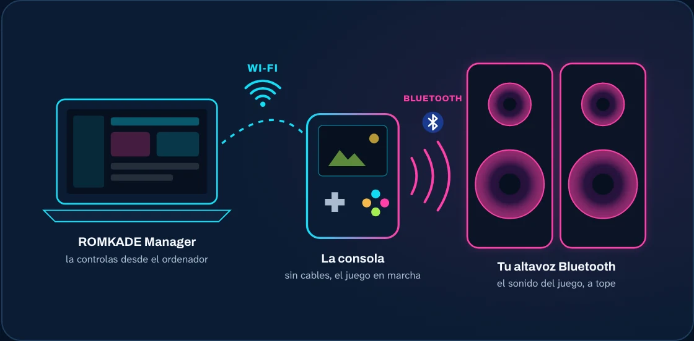

<p align="center">
  
</p>

<h3 align="center">Tu consola retro, por fin ordenada.<br>Contrólala desde tu ordenador, y pide a ChatGPT o Claude que empiece la partida.</h3>

<p align="center">
  <b><a href="https://romkade.com/es/">romkade.com</a></b> &nbsp;·&nbsp; <b><a href="https://romkade.com/es/compatibilidad/">¿Es compatible mi consola?</a></b>
  <br><a href="README.md">English</a> · <a href="README.fr.md">Français</a> · <b>Español</b>
</p>

<p align="center">
  <a href="https://romkade.com/video/hero-es.mp4"></a>
  <br><sub>Ver la presentación en 50 segundos</sub>
</p>

**ROMKADE Manager** convierte tu consola retro portátil en una consola que controlas desde tu ordenador. Toda tu
tarjeta microSD se convierte en una bonita biblioteca de juegos, **Duke**, tu asistente IA, conoce cada uno de ellos, e
incluso puedes hablar con tu consola desde ChatGPT, Claude o Google Home. Sin cable y sin sacar la tarjeta: todo va por
Wi-Fi.

## ¿Es compatible tu consola?

| | Consolas y sistemas |
|---|---|
| **Verificadas** | Anbernic RG35XX (Pro, Plus, H, SP, 2024), RG28XX, RG34XX, RG40XX, RG CubeXX con Stock OS Mod · Miyoo Mini y Mini Plus con Onion OS |
| **Experimentales** | Knulli, Batocera, ROCKNIX, muOS, ArkOS, spruce, MinUI / NextUI, Android con RetroArch |

Encuentra tu modelo exacto y lo que funciona en él: **[romkade.com/es/compatibilidad](https://romkade.com/es/compatibilidad/)**.

## Toda tu biblioteca retro, de un vistazo

<p align="center"></p>

Cada juego de tu tarjeta, ordenado por consola, con su carátula, su resumen, su tráiler y su género. Alrededor de la
biblioteca:

- **La búsqueda**, que encuentra un juego, una consola o un género, aunque escribas mal.
- **Los favoritos**, para tener tus mejores juegos a un clic.
- **Las partidas guardadas**, copiadas en tu ordenador en un clic, restauradas cuando las necesites, y las partidas retomadas donde las dejaste.
- **Las capturas de pantalla** tomadas durante el juego, guardadas con cada juego.
- **Añadir juegos arrastrando y soltando**, por Wi-Fi, directamente en la carpeta correcta, comprobados antes de copiar nada.
- **El tiempo de juego**: cuánto juegas a cada juego, con avisos si quieres.

## Duke, el asistente IA que conoce tus juegos y controla tu consola

<p align="center"></p>

Habla con Duke como con un amigo que conoce toda tu colección y que tiene la consola en la mano. Cada acción en la
consola espera tu clic.

- **Conoce tus juegos.** «¿Un juego para dos en mi biblioteca?», «Compara estos dos.» En el juego en marcha: los
  controles, los objetivos y ayuda para superar una parte difícil, primero una pista, la solución completa solo si la
  pides.
- **Controla tu consola.** Abrir un juego, salir, guardar tu partida, subir, bajar o quitar el sonido, hacer una
  captura de pantalla.
- **Ve tu pantalla.** Haz una captura y pregúntale: mira la imagen para ayudarte.
- **Local o en línea, tú eliges.** Ejecuta la IA en tu propio ordenador (Ollama, LM Studio): nada sale de tu casa. O
  conecta un modelo en línea con tu propia clave.
- **Desde cualquier sitio, con ChatGPT, Claude o Google Home.** Conecta tu consola a tu cuenta ROMKADE y pide «Abre
  Tetris» desde tu móvil o tu ordenador.

## El mando adecuado para cada jugador, en un clic

<p align="center"></p>

Empareja tus mandos Bluetooth desde tu ordenador, ve todos los conectados a la consola y da uno a cada jugador.
ROMKADE Manager aplica tu elección a tus juegos: conecta la consola a tu tele y juega a dos en pantalla grande, sin
rebuscar en los menús de la consola.

## Conecta tu consola a tu altavoz Bluetooth

<p align="center"></p>

ROMKADE Manager busca los dispositivos Bluetooth alrededor de la consola. Elige tu altavoz o tus auriculares: la
consola se conecta y el sonido del juego sale a tope. Un clic devuelve el sonido a la consola.

## Empieza en 3 pasos

1. **Instala Docker Desktop**, gratuito en macOS, Windows y Linux.
2. **Inicia ROMKADE Manager.** En un terminal, en una carpeta vacía:

   ```bash
   curl -fsSLO https://github.com/RomKade/romkade-manager/releases/latest/download/compose.yaml
   docker compose up -d
   ```

   En Windows, escribe `curl.exe` en lugar de `curl`.
3. **Abre http://localhost:8765**, crea tu cuenta ROMKADE y déjate guiar: ROMKADE Manager encuentra tu consola en la
   red por ti.

Guía paso a paso, con capturas: **[romkade.com/es/instalacion](https://romkade.com/es/instalacion/)**.
Próximamente: la instalación en un clic desde las Extensiones de Docker Desktop.

## Tus juegos, tu consola

- **Ningún juego incluido.** ROMKADE Manager ordena los archivos que ya tienes.
- **Tus datos se quedan en casa.** Biblioteca, partidas guardadas y ajustes viven en tu ordenador.
- **Nada cambia sin ti.** La consola solo se modifica cuando lo pides: añadir juegos, restaurar una partida guardada, ajustes de mandos o de Bluetooth.
- **Privado por diseño.** La interfaz solo se abre en tu ordenador, nunca en Internet.

## Bajo el capó

Python (FastAPI) y SQLite en el servidor, una interfaz React, Typesense para la búsqueda, todo empaquetado con Docker
para Intel/AMD y ARM. ROMKADE Manager llega a la consola por SSH en tu red local; ROMKADE Cloud, un servidor MCP, la
conecta con ChatGPT, Claude y Google Home. Instalación desde el código fuente, desarrollo y cada función en detalle:
[referencia técnica](docs/reference.es.md).

## Licencia

© 2026 ROMKADE. El código se publica para lectura y evaluación; cualquier otro uso requiere el permiso por escrito de
ROMKADE (ver [LICENSE](LICENSE)). ROMKADE no está afiliado a ningún fabricante de consolas; las marcas citadas
pertenecen a sus propietarios.
