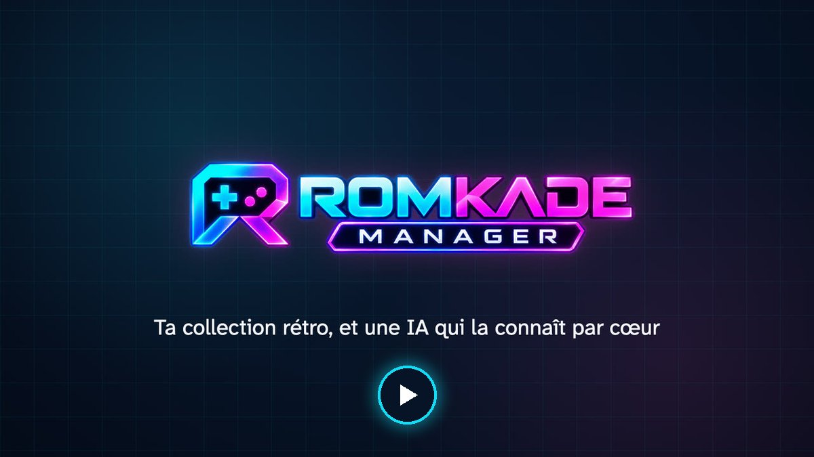
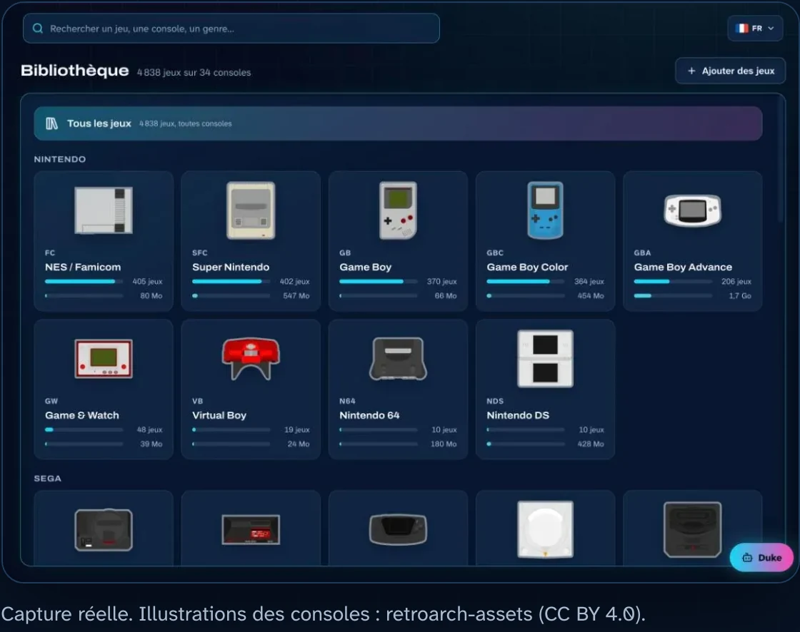
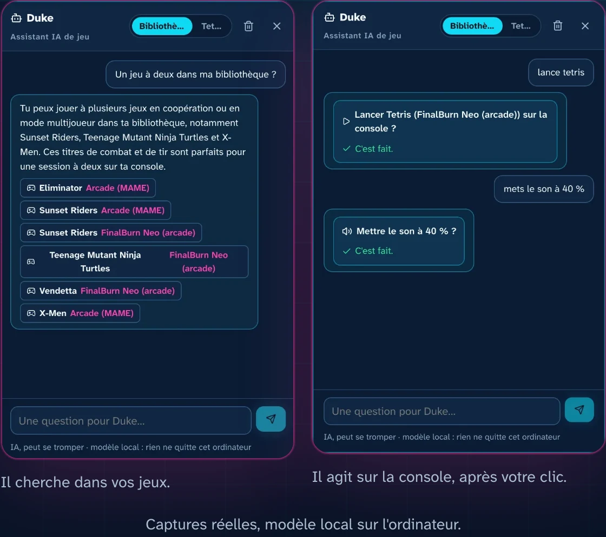
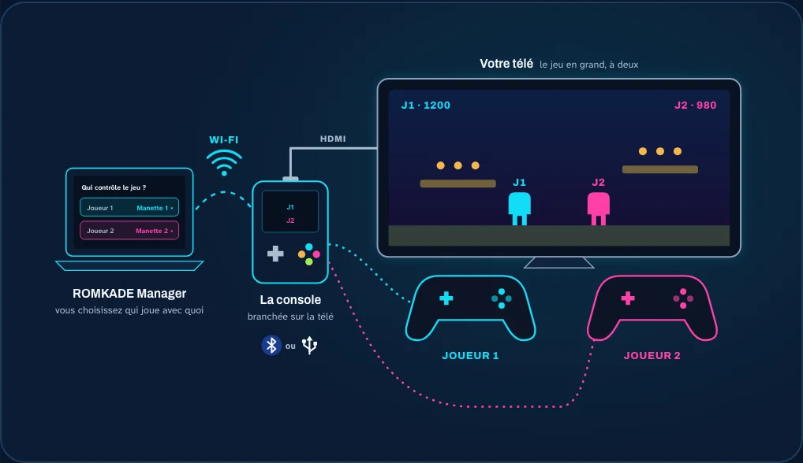
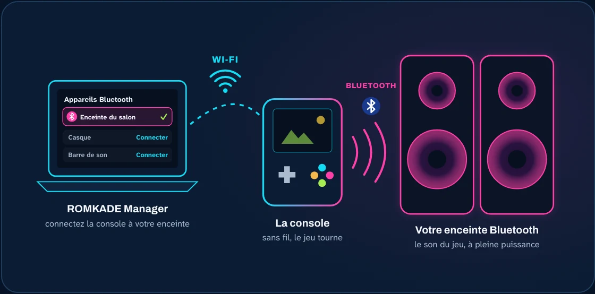

<p align="center">
  
</p>

<h3 align="center">Ta console rétro, enfin rangée.<br>Pilote-la depuis ton ordinateur, et demande simplement à ChatGPT ou Claude de lancer une partie.</h3>

<p align="center">
  <b><a href="https://romkade.com">romkade.com</a></b> &nbsp;·&nbsp; <b><a href="https://romkade.com/compatibilite/">Ma console est-elle compatible ?</a></b>
  <br><a href="README.md">English</a> · <b>Français</b> · <a href="README.es.md">Español</a>
</p>

<p align="center">
  <a href="https://romkade.com/video/hero-fr.mp4"></a>
  <br><sub>Voir la présentation en 50 secondes</sub>
</p>

**ROMKADE Manager** fait de ta console rétro portable une console que tu pilotes depuis ton ordinateur. Toute ta carte
microSD devient une belle bibliothèque de jeux, **Duke**, ton assistant IA, connaît chacun d'eux, et tu peux même parler
à ta console depuis ChatGPT, Claude ou Google Home. Pas de câble, pas besoin de sortir la carte : tout passe par le Wi-Fi.

## Ta console est-elle compatible ?

| | Consoles et systèmes |
|---|---|
| **Vérifiées** | Anbernic RG35XX (Pro, Plus, H, SP, 2024), RG28XX, RG34XX, RG40XX, RG CubeXX avec Stock OS Mod · Miyoo Mini et Mini Plus avec Onion OS |
| **Expérimentales** | Knulli, Batocera, ROCKNIX, muOS, ArkOS, spruce, MinUI / NextUI, Android avec RetroArch |

Trouve ton modèle exact et ce qui fonctionne dessus : **[romkade.com/compatibilite](https://romkade.com/compatibilite/)**.

## Toute ta bibliothèque rétro, d'un coup d'œil

<p align="center"></p>

Chaque jeu de ta carte, rangé par console, avec sa jaquette, son résumé, sa bande-annonce et son genre. Autour de la
bibliothèque :

- **La recherche**, qui trouve un jeu, une console ou un genre, même avec une faute de frappe.
- **Les favoris**, pour garder tes meilleurs jeux à portée de clic.
- **Les sauvegardes**, copiées sur ton ordinateur en un clic, restaurées quand tu en as besoin, et les parties reprises là où tu les avais laissées.
- **Les captures d'écran** prises en jeu, rangées avec chaque jeu.
- **L'ajout de jeux par glisser-déposer**, en Wi-Fi, directement dans le bon dossier, vérifiés avant toute copie.
- **Le temps de jeu** : combien de temps tu joues à chaque jeu, avec des rappels si tu veux.

## Duke, l'assistant IA qui connaît tes jeux

<p align="center"></p>

Demande à Duke tout ce que tu veux sur ta collection : « Un jeu à deux ? », « Comment passer ce niveau ? ». Il cherche
dans ta bibliothèque, propose des jeux et agit sur la console quand tu cliques : lancer un jeu, régler le volume.

- **En local ou en ligne, au choix.** Fais tourner l'IA sur ton propre ordinateur (Ollama, LM Studio) : rien ne sort de
  chez toi. Ou branche un modèle en ligne avec ta propre clé.
- **De partout, avec ChatGPT, Claude ou Google Home.** Relie ta console à ton compte ROMKADE et demande « Lance
  Tetris » depuis ton téléphone ou ton ordinateur.

## La bonne manette pour chaque joueur, en un clic

<p align="center"></p>

Associe tes manettes Bluetooth depuis ton ordinateur, vois toutes celles branchées sur la console et donnes-en une à
chaque joueur. ROMKADE Manager applique ton choix à tes jeux : branche la console sur ta télé et joue à deux sur grand
écran, sans fouiller dans les menus de la console.

## Connecte ta console à ton enceinte Bluetooth

<p align="center"></p>

ROMKADE Manager cherche les appareils Bluetooth autour de la console. Choisis ton enceinte ou ton casque : la console
s'y connecte et le son du jeu sort à pleine puissance. Un clic renvoie le son vers la console.

## Démarrer en 3 étapes

1. **Installe Docker Desktop**, gratuit sur macOS, Windows et Linux.
2. **Lance ROMKADE Manager.** Dans un terminal, dans un dossier vide :

   ```bash
   curl -fsSLO https://github.com/RomKade/romkade-manager/releases/latest/download/compose.yaml
   docker compose up -d
   ```

   Sous Windows, tape `curl.exe` au lieu de `curl`.
3. **Ouvre http://localhost:8765**, crée ton compte ROMKADE et laisse-toi guider : ROMKADE Manager trouve ta console
   tout seul sur le réseau.

Guide pas à pas, avec captures : **[romkade.com/installation](https://romkade.com/installation/)**.
Bientôt : l'installation en un clic depuis les Extensions de Docker Desktop.

## Tes jeux, ta console

- **Aucun jeu fourni.** ROMKADE Manager range les fichiers que tu possèdes déjà.
- **Tes données restent chez toi.** Bibliothèque, sauvegardes et réglages vivent sur ton ordinateur.
- **Rien ne change sans toi.** La console n'est modifiée que quand tu le demandes : ajout de jeux, restauration d'une sauvegarde, réglages des manettes ou du Bluetooth.
- **Privé par conception.** L'interface ne s'ouvre que sur ton ordinateur, jamais sur Internet.

## Sous le capot

Python (FastAPI) et SQLite côté serveur, une interface React, Typesense pour la recherche, le tout emballé avec Docker
pour Intel/AMD et ARM. ROMKADE Manager joint la console en SSH sur ton réseau local ; ROMKADE Cloud, un serveur MCP,
y relie ChatGPT, Claude et Google Home. Installation depuis les sources, développement et chaque fonction en détail :
[référence technique](docs/reference.fr.md).

## Licence

© 2026 ROMKADE. Le code est publié pour lecture et évaluation ; tout autre usage demande l'accord écrit de ROMKADE
(voir [LICENSE](LICENSE)). ROMKADE n'est affilié à aucun fabricant de consoles ; les marques citées appartiennent à
leurs propriétaires.
