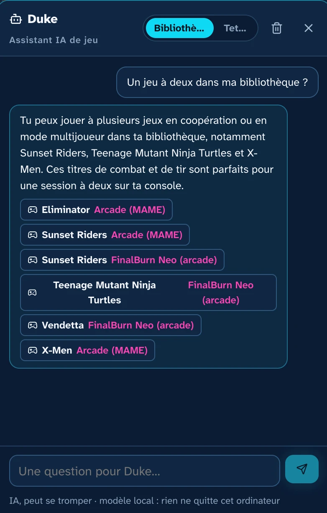
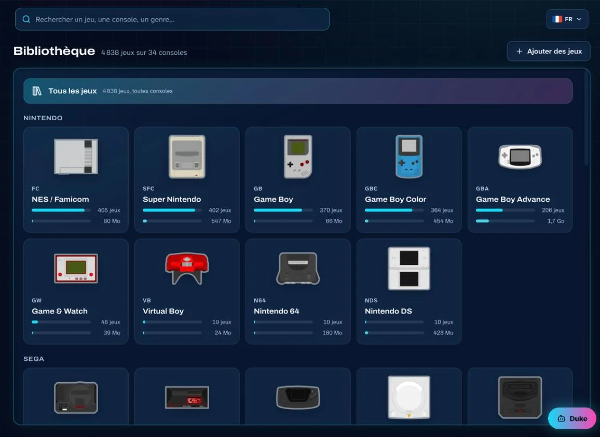
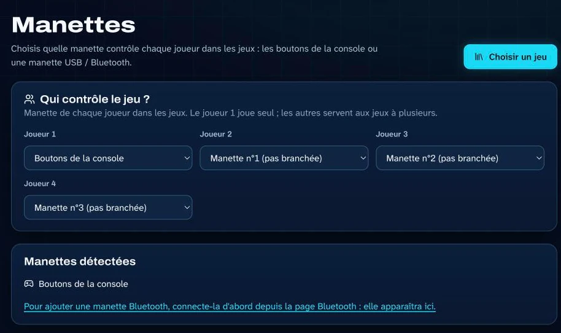
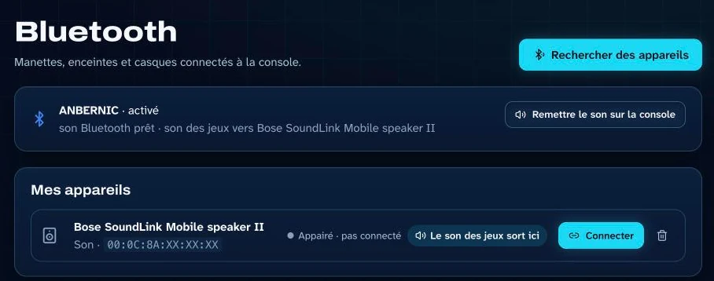

<p align="center">
  
</p>

<h3 align="center">Ta console rétro, enfin rangée.<br>Pilote-la depuis ton ordinateur, et demande simplement à ChatGPT ou Claude de lancer une partie.</h3>

<p align="center">
  <b><a href="https://romkade.com">romkade.com</a></b> &nbsp;·&nbsp; <a href="README.md">English</a> · <b>Français</b> · <a href="README.es.md">Español</a>
</p>

<p align="center">
  <a href="https://romkade.com/video/hero-fr.mp4"></a>
  <br><sub>▶ Voir la présentation en 50 secondes</sub>
</p>

---

**ROMKADE Manager** fait de ta console rétro portable (Anbernic, Miyoo, TrimUI…) une console que tu pilotes depuis ton
ordinateur. Toute ta carte microSD devient une belle bibliothèque, avec jaquettes et fiches de jeu, et **Duke**, ton
assistant IA, connaît chacun de tes jeux. Pas de câble, pas besoin de sortir la carte : tout passe par le Wi-Fi.

## ✨ Ce que tu peux faire

- 📚 **Voir toute ta collection.** Chaque jeu de la carte, avec jaquette, résumé, bande-annonce et genre. La recherche le trouve même avec une faute de frappe.
- 🤖 **Demander à Duke.** « Un jeu à deux ? », « Comment passer ce niveau ? » : l'assistant IA connaît ta bibliothèque et lance les jeux pour toi.
- 💬 **Parler à ta console depuis ChatGPT, Claude ou Google Home.** « Lance Tetris », « Mets le son à 40 % », depuis ton téléphone ou ton ordinateur.
- 🎮 **Jouer depuis ton ordinateur.** Lancer un jeu, le quitter, reprendre une sauvegarde, régler le volume.
- ➕ **Ajouter des jeux par glisser-déposer.** En Wi-Fi, directement dans le bon dossier, vérifiés avant toute copie.
- 💾 **Mettre tes sauvegardes à l'abri.** Toutes copiées sur ton ordinateur en un clic, et restaurées quand tu en as besoin.
- 🕹️ **Manettes et son Bluetooth.** Choisis qui joue avec quelle manette, envoie le son sur une enceinte Bluetooth.
- ⏳ **Temps de jeu.** Combien de temps tu joues, avec des rappels si tu veux.

<table>
  <tr>
    <td width="50%"><p align="center"><sub>Duke connaît tes jeux</sub></p></td>
    <td width="50%"><p align="center"><sub>Ta bibliothèque, console par console</sub></p></td>
  </tr>
  <tr>
    <td width="50%"><p align="center"><sub>Qui joue avec quelle manette</sub></p></td>
    <td width="50%"><p align="center"><sub>Le son du jeu sur une enceinte</sub></p></td>
  </tr>
</table>

## 🎮 Compatible avec ta console

| | Consoles et systèmes |
|---|---|
| ✅ **Vérifiées** | Anbernic RG35XX (Pro, Plus, H, SP, 2024), RG28XX, RG34XX, RG40XX, RG CubeXX avec Stock OS Mod · Miyoo Mini et Mini Plus avec Onion OS |
| 🧪 **Expérimentales** | Knulli, Batocera, ROCKNIX, muOS, ArkOS, spruce, MinUI / NextUI, Android avec RetroArch |

Il suffit que ta console soit sur le même Wi-Fi que ton ordinateur.

## 🚀 Démarrer en 3 étapes

1. **Installe Docker Desktop**, gratuit sur macOS, Windows et Linux.
2. **Lance ROMKADE Manager.** Dans un terminal, dans un dossier vide :

   ```bash
   curl -fsSLO https://github.com/RomKade/romkade-manager/releases/latest/download/compose.yaml
   docker compose up -d
   ```

   Sous Windows, tape `curl.exe` au lieu de `curl`.
3. **Ouvre http://localhost:8765**, crée ton compte ROMKADE et laisse-toi guider : ROMKADE Manager trouve ta console
   tout seul sur le réseau.

Guide pas à pas, avec captures : **[romkade.com/installation](https://romkade.com/installation/)**.
Bientôt : l'installation en un clic depuis les Extensions de Docker Desktop.

## 🔒 Tes jeux, ta console

- **Aucun jeu fourni.** ROMKADE Manager range les fichiers que tu possèdes déjà.
- **Tes données restent chez toi.** Bibliothèque, sauvegardes et réglages vivent sur ton ordinateur.
- **Rien ne change sans toi.** La console n'est modifiée que quand tu le demandes : ajout de jeux, restauration d'une sauvegarde, réglages des manettes ou du Bluetooth.
- **Privé par conception.** L'interface ne s'ouvre que sur ton ordinateur, jamais sur Internet.

## 🛠️ Sous le capot

Python (FastAPI) et SQLite côté serveur, une interface React, Typesense pour la recherche, le tout emballé avec Docker
pour Intel/AMD et ARM. ROMKADE Manager joint la console en SSH sur ton réseau local ; ROMKADE Cloud, un serveur MCP,
y relie ChatGPT, Claude et Google Home. Installation depuis les sources, développement et chaque fonction en détail :
[référence technique](docs/reference.fr.md).

## Licence

© 2026 ROMKADE. Le code est publié pour lecture et évaluation ; tout autre usage demande l'accord écrit de ROMKADE
(voir [LICENSE](LICENSE)). ROMKADE n'est affilié à aucun fabricant de consoles ; les marques citées appartiennent à
leurs propriétaires.
