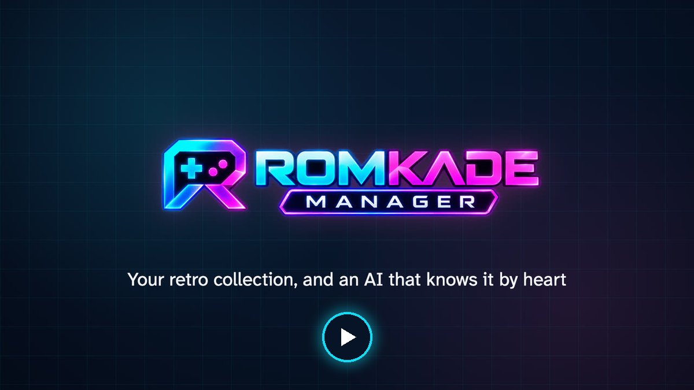
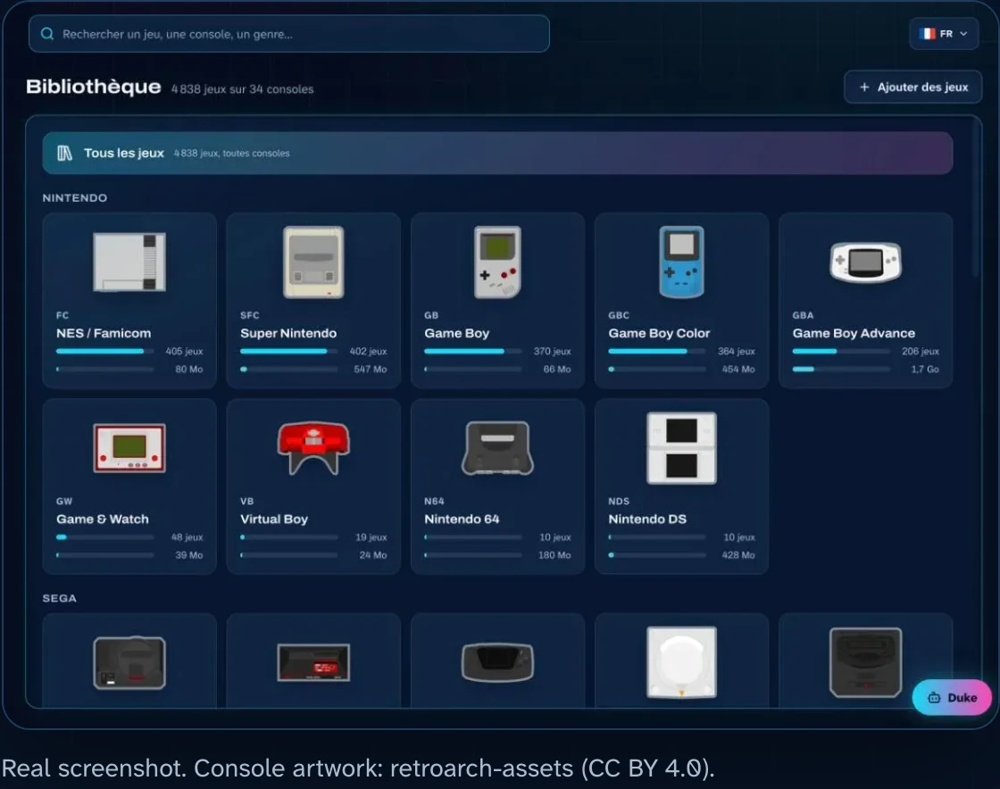
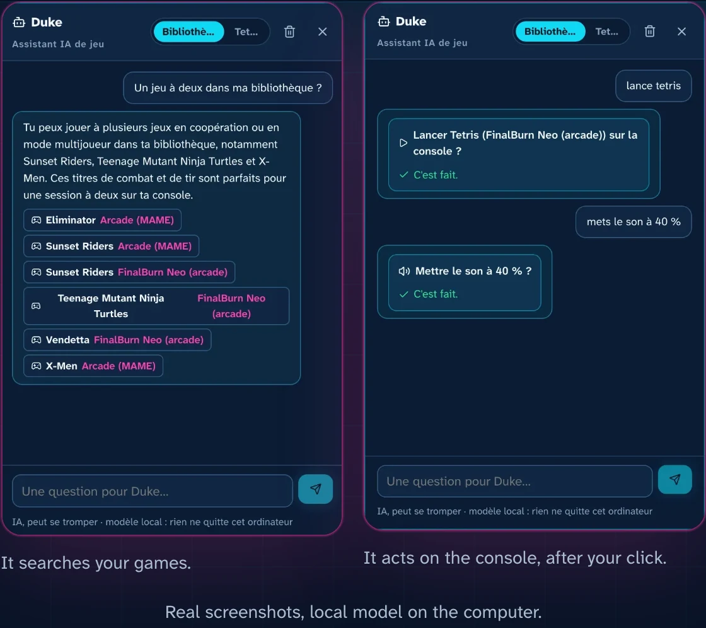
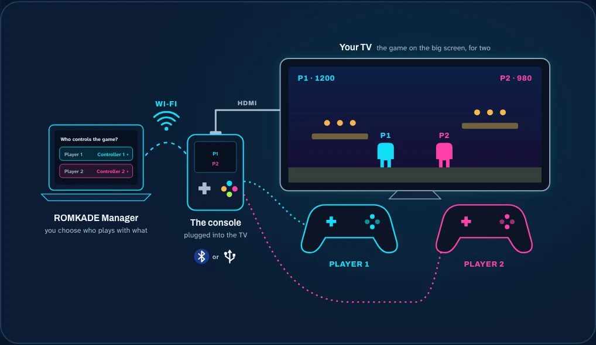
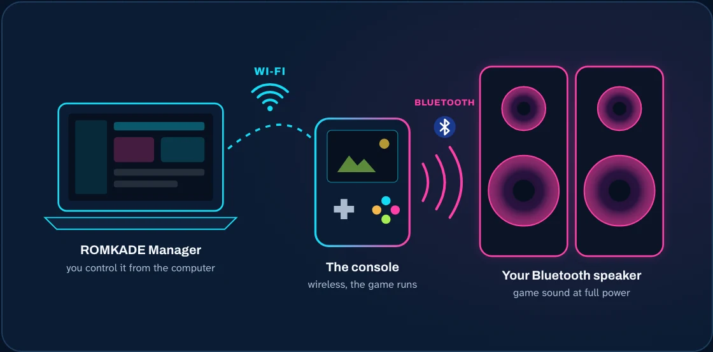

<p align="center">
  
</p>

<h3 align="center">Your retro handheld, finally organized.<br>Manage it from your computer, and just ask ChatGPT or Claude to play.</h3>

<p align="center">
  <b><a href="https://romkade.com/en/">romkade.com</a></b> &nbsp;·&nbsp; <b><a href="https://romkade.com/en/compatibility/">Is my console compatible?</a></b>
  <br><b>English</b> · <a href="README.fr.md">Français</a> · <a href="README.es.md">Español</a>
</p>

<p align="center">
  <a href="https://romkade.com/video/hero-en.mp4"></a>
  <br><sub>Watch the 50-second presentation</sub>
</p>

**ROMKADE Manager** turns your retro handheld into a console you control from your computer. Your whole microSD card
becomes a beautiful game library, **Duke**, your AI assistant, knows every game on it, and you can even talk to your
console from ChatGPT, Claude or Google Home. No cable, no pulling out the card: everything happens over Wi-Fi.

## Is your console compatible?

| | Consoles and systems |
|---|---|
| **Verified** | Anbernic RG35XX (Pro, Plus, H, SP, 2024), RG28XX, RG34XX, RG40XX, RG CubeXX with Stock OS Mod · Miyoo Mini and Mini Plus with Onion OS |
| **Experimental** | Knulli, Batocera, ROCKNIX, muOS, ArkOS, spruce, MinUI / NextUI, Android with RetroArch |

Find your exact model and what works on it: **[romkade.com/en/compatibility](https://romkade.com/en/compatibility/)**.

## Your whole retro library, at a glance

<p align="center"></p>

Every game on your card, sorted by console, with its box art, summary, trailer and genre. Around the library:

- **Search** that finds a game, a console or a genre, even with a typo.
- **Favorites** to keep your best games one click away.
- **Saves** copied to your computer in one click, restored when you need them, and games resumed right where you left off.
- **Screenshots** taken during the game, kept with each game.
- **Add games by drag and drop**, over Wi-Fi, straight into the right folder, checked before anything is copied.
- **Playtime**: how long you play each game, with optional reminders.

## Duke, the AI assistant that knows your games

<p align="center"></p>

Ask Duke anything about your collection: “A two-player game?”, “How do I beat this level?”. It searches your library,
suggests games and acts on the console when you click: launch a game, change the volume.

- **Local or online, your choice.** Run the AI on your own computer (Ollama, LM Studio): nothing leaves your home. Or
  plug in an online model with your own key.
- **From anywhere, with ChatGPT, Claude or Google Home.** Link your console to your ROMKADE account and ask “Launch
  Tetris” from your phone or your computer.

## Two players on the TV, each with their controller

<p align="center"></p>

Plug the console into your TV and play on the big screen, two players, each with their own controller (Bluetooth or USB).
From your computer, choose who plays with which one: the setting is applied to your games.

## Game sound on your Bluetooth speaker

<p align="center"></p>

Pair a Bluetooth speaker with the console from your computer, and play with the sound at full power.

## Get started in 3 steps

1. **Install Docker Desktop**, free on macOS, Windows and Linux.
2. **Start ROMKADE Manager.** In a terminal, in an empty folder:

   ```bash
   curl -fsSLO https://github.com/RomKade/romkade-manager/releases/latest/download/compose.yaml
   docker compose up -d
   ```

   On Windows, type `curl.exe` instead of `curl`.
3. **Open http://localhost:8765**, create your ROMKADE account and follow the guided setup: ROMKADE Manager finds your
   console on the network for you.

Step-by-step guide with screenshots: **[romkade.com/en/installation](https://romkade.com/en/installation/)**.
Coming soon: install in one click from Docker Desktop's Extensions.

## Your games, your console

- **No games provided.** ROMKADE Manager organizes the files you already own.
- **Your data stays at home.** Library, saves and settings live on your computer.
- **Nothing changes without you.** The console is only modified when you ask: adding games, restoring a save, controller or Bluetooth settings.
- **Private by design.** The interface only opens on your computer, never on the Internet.

## Under the hood

Python (FastAPI) and SQLite on the server side, a React interface, Typesense for search, all packaged with Docker for
Intel/AMD and ARM. ROMKADE Manager reaches the console over SSH on your local network; ROMKADE Cloud, an MCP server,
connects ChatGPT, Claude and Google Home to it. Installation from source, development and every feature in detail:
[technical reference](docs/reference.md).

## License

© 2026 ROMKADE. The code is published for reading and evaluation; any other use needs ROMKADE's written permission
(see [LICENSE](LICENSE)). ROMKADE is not affiliated with any console maker; trademarks belong to their owners.
